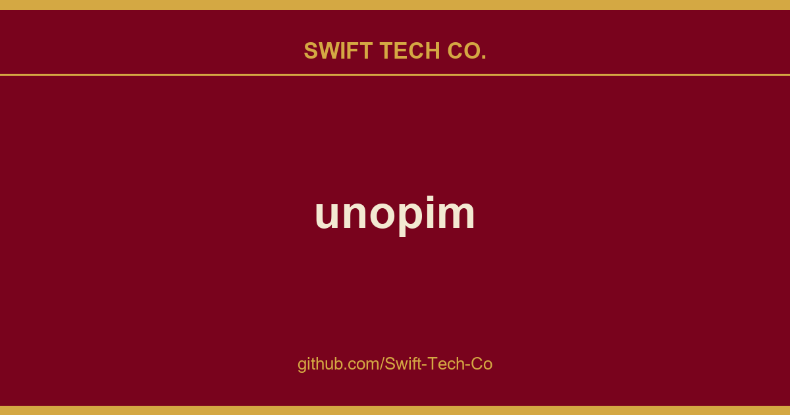

# unopim

## What This Is

Every project needs a shelf of ready answers. product and engineering is one of those shelves, and unopim is the entry on it - the notes, patterns and fixes we reuse when this kind of work comes up.

## Images

[](https://github.com/Swift-Tech-Co/unopim)

## 🎥 Watch & Learn

<table>
  <tr>
    <td align="center" width="33%">
      <a href="https://github.com/Swift-Tech-Co/unopim">
        <br>
        <sub><b>Introducing Open Source PIM  UnoPim</b></sub>
      </a>
    </td>
    <td align="center" width="33%">
      <a href="https://github.com/Swift-Tech-Co/unopim">
        <br>
        <sub><b>10M Products? Meet UnoPim</b></sub>
      </a>
    </td>
    <td align="center" width="33%">
      <a href="https://github.com/Swift-Tech-Co/unopim">
        <br>
        <sub><b>CSV Import 10x Faster</b></sub>
      </a>
    </td>
  </tr>
</table>

> Upgrading from an older version? See the [Upgrade Guide](UPGRADE.md) and [CHANGELOG](CHANGELOG.md) for full release notes.

## ⚙️ Scalability

UnoPim is engineered for high-volume catalogues. Read how UnoPim scales to handle over 10 million products, or download the UnoPim at Scale whitepaper (PDF) for the full benchmarks.

<p align="center">
  <a href="https://github.com/Swift-Tech-Co/unopim">
    
  </a>
</p>

## ✨ Features

- **AI Agent Chat**
  Manage products through natural language  search, create, update, bulk edit, export, categorize, and generate content via conversational AI with multi-step tool calling.
    <p></p>
    
- **Magic AI with Multi-Platform Support**
  Generate product content, images, and translations using 10+ AI providers. Configure and manage AI platforms with encrypted credential storage, connection testing, and dynamic model selection.
  <p></p>

- **Advanced AI-Powered Product Management**
    Create compelling product content, generate high-quality images, and gain actionable insights with intelligent automation. Leverage customizable dashboards, seamless multi-user collaboration, and smart reporting tools to streamline workflows and boost productivity across your entire platform.
  <p></p>

- **Centralized Product Management**
  Manage all your product data in one place.

  <p></p>

- **Data Enrichment**
  Enhance your product information with detailed attributes and descriptions.

  <p></p>

- **Dashboard with Analytics**
  Monitor channel readiness, product trends, recent activity, and items needing attention at a glance.

    <p></p>
- **User Management**
  Control user access and permissions.

  <p></p>

- **API Integration**
  Seamlessly integrate with other systems via RESTful APIs. Import our official Postman collection or browse the full API documentation.

  <p></p>

- **Localization**
  Support for 33 languages and locales out of the box.

  <p></p>

- **Multi-Channel**
  Support for multiple sales channels.

  <p></p>

- **Multi-Currency**
  Support for multiple currencies.

  <p></p>

- **Import/Export with Real-Time Tracker**
  Import and export product data using CSV, XLSX, and ZIP formats with real-time step-by-step progress tracking, pipeline visualization, and job-specific logging. Optimized for high-volume data handling with eager loading, increased batch sizes, and deferred indexing.

  <p></p>

- **Themes**
  UI compatible with both Light and Dark themes.

  <p></p>

- **Version Control**
  Track the history of changes in your product data.

  <p></p>

- **Digital Product Passport**
  Build DPP templates, attach QR carriers, and publish per-product passports to a public tier  with the publish path gated behind its own permission and queue.

- **Publication Channels**
  Push enriched product payloads to downstream destinations on a queue, with per-channel payloads and delivery records.

- **Product Completeness**
  Score every product against the attributes a family marks required per channel, and surface what is missing before it ships.

- **Measurement Families**
  Define units and conversions once, then let measurement attributes capture an amount and a unit together.

- **Configurable Products & Associations**
  Model variant structures with multi-level axes, and relate products through configurable association types.

- **Webhooks**
  Notify external systems on product events over an asynchronous `webhooks` queue, so subscriber HTTP calls never block a save.

## 🧩 Extensions

Free, officially maintained extensions:

- **UnoPim DAM**  Digital Asset Management: file and directory management, asset upload and preview, metadata tagging, and CSV/XLSX asset assignment.
- **Shopify Connector**  sync product data, prices, descriptions, and images with a Shopify store.
- **Bagisto Connector**  sync products, attributes, and media into a Bagisto storefront, with customizable mappings.

More connectors and modules are listed on the UnoPim extensions marketplace. Extensions are ordinary Concord packages  see the developer documentation to build your own.

## 🚀 Installation

UnoPim supports MariaDB as a primary application datastore, alongside MySQL and PostgreSQL. UnoPim 3.1.0 added first-class MariaDB support for installation, upgrades, migrations, audit logs, and REST APIs. Composer installations default to MySQL; the supplied Docker stack defaults to PostgreSQL.

> **Requirements:** Nginx/Apache2, PHP 8.4.1+, Composer 2.6+, and MariaDB 10.11 LTS or 11.8 LTS, MySQL 8.0.32+, or PostgreSQL 16. Node 22 LTS is recommended for asset builds.
>
> **Elasticsearch is optional.** It is off by default (`ELASTICSEARCH_ENABLED=false`) and search and filtering fall back to the database, so a working install needs no Elasticsearch node. Set `ELASTICSEARCH_ENABLED=true` to index large catalogues; both Docker stacks already ship an Elasticsearch 8 service.
>
> **PHP extensions:** `calendar`, `curl`, `intl`, `mbstring`, `openssl`, `pdo`, `pdo_mysql`, `tokenizer`  these are hard `composer.json` requirements and `composer install` fails without them. The upgrade preflight additionally checks `json`, `xml`, `gd`, `zip` and `fileinfo`.
>
> **On PostgreSQL:** `ext-pdo_mysql` is currently required by `composer.json` regardless of the database you run, so it must be installed even on a PostgreSQL-only host. Install `ext-pdo_pgsql` as well and set `DB_CONNECTION=pgsql`.

> **On MariaDB:** Use the latest patch of 10.11 LTS or 11.8 LTS, enable `pdo_mysql`, and set `DB_CONNECTION=mariadb`. Install `mariadb-dump` on the application host for upgrade backups. Community 10.6 and 10.10 are end of life; consult the MariaDB maintenance policy.

See the 3.1 requirements, MariaDB installation guide, or Installation Guide  or pick a quick path below.

### Composer

```bash
composer create-project unopim/unopim
cd unopim
php artisan unopim:install
php artisan serve
```

Open `https://github.com/Swift-Tech-Co/unopim in your browser. To execute imports/exports, AI agent tasks, completeness jobs, webhook deliveries, and Digital Product Passport publishing, start the queue worker:

```bash
php artisan queue:work --queue=webhooks,system,completeness,default,publication
```

> **Note:** The `webhooks` queue is required for outgoing webhook delivery. The `Webkul\Webhook\Listeners\Product` listener is dispatched asynchronously to this queue so product save/update requests are not blocked by HTTP calls to subscribers. If you omit `webhooks` from the `--queue` list, webhook events will queue up but never be processed.

> **Note:** The `publication` queue processes Digital Product Passport publish jobs (single and bulk). Omit it and passports will queue but never publish. If you run a process manager such as Supervisor, add `publication` to your worker's `--queue=` list and restart it (e.g. `sudo supervisorctl restart unopim-worker`).

### Docker

Requires Docker + Docker Compose v2+. See the full Docker guide for advanced configuration.

**Run UnoPim**  pre-built images, no checkout, no configuration:

```bash
curl -O https://github.com/Swift-Tech-Co/unopim
docker compose up -d
```

Open `https://github.com/Swift-Tech-Co/unopim Set the admin credentials **before** the first `docker compose up`, in a `.env` file next to `compose.yaml`:

```bash
INSTALLER_ADMIN_EMAIL=you@example.com
INSTALLER_ADMIN_PASSWORD=<a password you choose>
```

If you leave them blank, the seeder generates a random 20-character password and writes it to `storage/app/admin-credentials.txt` inside the container:

```bash
docker compose exec unopim cat storage/app/admin-credentials.txt
```

Change it after the first login. Every other setting has a working default; override any of them by exporting it or putting it in that same `.env` file.

**MySQL instead of PostgreSQL:**

```bash
curl -O https://github.com/Swift-Tech-Co/unopim
docker compose -f compose.yaml -f compose.mysql.yaml up -d
```

> Switching engines on an existing install needs a fresh database  data is not migrated between them.

**Develop UnoPim**  builds from your checkout and bind-mounts it, so edits are live:

```bash
git clone https://github.com/Swift-Tech-Co/unopim
cd unopim
cp .env.docker .env
docker compose -f compose.dev.yaml up -d
```

First boot installs Composer dependencies into `./vendor`. The stack defaults to **Nginx + PHP-FPM** and **PostgreSQL 16**; for Apache use `-f compose.dev.yaml -f compose.dev.apache.yaml`, and for MySQL set `COMPOSE_PROFILES=mysql`, `DB_CONNECTION=mysql`, `DB_HOST=unopim-mysql`, `DB_PORT=3306` in `.env` before the first `up`.

> **Port conflicts?** If you already have MySQL, Redis, or Elasticsearch running locally, edit the `FORWARD_*` ports in `.env` and restart. See `.env.docker` for details.

**Deploying?** Inject `APP_KEY` as a secret rather than letting the container generate one, and set `UNOPIM_SKIP_MIGRATIONS=true` where the schema is managed by the deployment itself  a Kubernetes Job or a release step  so scaled replicas do not race each other.

### ☁️ Cloud Hosting (Managed  no setup)
<p>
  <a href="https://github.com/Swift-Tech-Co/unopim">
    
  </a>
</p>

### ☁️ AWS Marketplace
<p>
  <a href="https://github.com/Swift-Tech-Co/unopim">
    
  </a>
</p>

Pre-configured AMIs  Ubuntu LEMP with Redis, Elasticsearch and phpMyAdmin:

- **UnoPim on AWS (x86_64)**
- **UnoPim on AWS (ARM64 / Graviton)**

## 🤝 Contributing

Found a bug or want to add a feature? Open an issue or submit a pull request  see [CONTRIBUTING.md](.github/CONTRIBUTING.md) for the full flow.

## 👥 Community

<p align="center">
  <a href="https://github.com/Swift-Tech-Co/unopim"></a>
  <a href="https://github.com/Swift-Tech-Co/unopim"></a>
  <a href="https://github.com/Swift-Tech-Co/unopim"></a>
  <a href="https://github.com/Swift-Tech-Co/unopim"></a>
</p>

Have questions, feedback, or want to contribute? Reach out through any of the channels above  we're always happy to hear from fellow PIM builders.

## 🔒 Security

## 📝 License

UnoPim is open-source software distributed under the [MIT License](LICENSE).

---

## Swift Tech Co.

Built and maintained by Swift Tech Co.

AI Automation | FinTech Platforms | Custom Software and Mobile Apps | SaaS Platforms | Cloud Infrastructure | Cybersecurity | SEO and Marketing | API Integration

**Join our community on Telegram:** [t.me/+Qt_eFvkb2rliMzNh](https://t.me/+Qt_eFvkb2rliMzNh)

Home | Services | Careers | Referral Program | Influencers | About | Contact

**Connect**

- Website: https://github.com/Swift-Tech-Co/unopim
- LinkedIn: [linkedin.com/in/stephenoladoke](https://www.linkedin.com/in/stephenoladoke/)
- LinkedIn (Company): [linkedin.com/company/swift-tech-co](https://www.linkedin.com/company/swift-tech-co)
- X: [@MrOladoke](https://x.com/MrOladoke)
- Instagram: [@mr.oladoke](https://www.instagram.com/mr.oladoke/)
- Organization: [github.com/Swift-Tech-Co](https://github.com/Swift-Tech-Co)

## Sources

Compiled and maintained from upstream [unopim/unopim](https://github.com/unopim/unopim) under permissive open-source license.

---

Maintained by [Swift Tech Co.](https://github.com/Swift-Tech-Co) - [Telegram](https://t.me/+Qt_eFvkb2rliMzNh)

## Sources

Compiled and maintained from upstream [unopim/unopim](https://github.com/unopim/unopim) under permissive open-source license.

---

Maintained by [Swift Tech Co.](https://github.com/Swift-Tech-Co) - [Telegram](https://t.me/+Qt_eFvkb2rliMzNh)

## Sources

Compiled and maintained from upstream [unopim/unopim](https://github.com/unopim/unopim) under permissive open-source license.

---

Maintained by [Swift Tech Co.](https://github.com/Swift-Tech-Co) - [Telegram](https://t.me/+Qt_eFvkb2rliMzNh)

## Sources

Compiled and maintained from upstream [unopim/unopim](https://github.com/unopim/unopim) under permissive open-source license.

---

Maintained by [Swift Tech Co.](https://github.com/Swift-Tech-Co) - [Telegram](https://t.me/+Qt_eFvkb2rliMzNh)